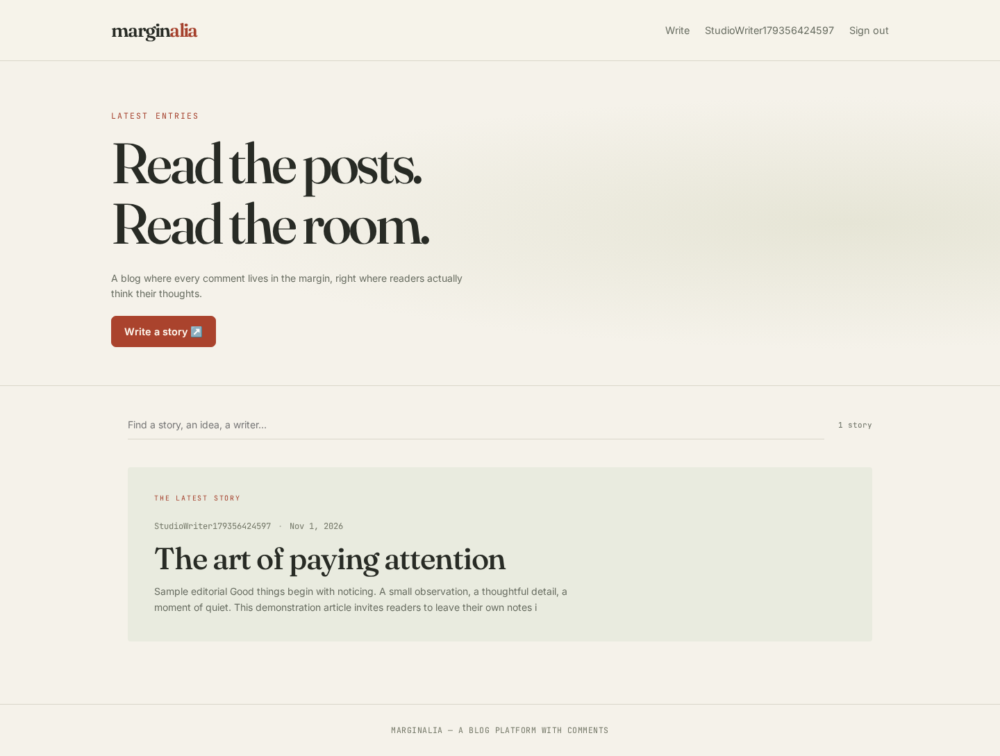

# Task 4 · Marginalia — Blog Platform with Comments

An editorial blogging platform with warm paper backgrounds, serif typography, searchable stories and comments in the article margin. Node.js/Express, MongoDB/Mongoose and a buildless HTML/CSS/JavaScript frontend.



## Run

Requires Node.js 20+ and MongoDB.

```sh
npm ci
cp .env.example .env
# Set MONGO_URI and a generated JWT_SECRET.
npm start
```

Open http://localhost:3000. Register, choose **Write**, and publish a story. New databases start empty; the screenshot contains a demonstration article created during browser testing.

## Features

- Registration, login/logout and persistent httpOnly-cookie sessions; production cookies require HTTPS.
- Author dashboard for creating, editing, deleting, publishing and saving drafts, with word count/read-time guidance.
- Drafts are visible only to their author, including direct URL/API requests; comments are accepted only on published posts.
- Readers can add comments and remove their own notes; only authors can edit/delete their posts.
- Published feed with client-side title/excerpt/author search, reading view and responsive margin notes.
- Ownership enforcement and plain-text rendering of reader content.

## REST API

`POST /api/auth/register`, `/login`, `/logout`; `GET /api/auth/me`; public published `GET /api/posts`; authenticated `GET /api/posts/mine`; `GET/PUT/DELETE /api/posts/:id`; `POST /api/posts`; `POST /api/posts/:id/comments`; `DELETE /api/posts/:id/comments/:commentId`.

## Verify

Against an isolated running test server:

```sh
node --test tests/api.test.cjs
```

Tests cover private drafts, publication, cross-user edit denial, comment ownership and deletion. Browser QA exercised registration, writing/publishing, reading and commenting, with desktop and [390px mobile previews](docs/mobile.png). `TEST_URL` overrides the test origin.

## Deploy

Connect to a Node host such as Render. Build `npm ci`, start `npm start`; configure `MONGO_URI`, generated `JWT_SECRET`, `NODE_ENV=production`, and optionally `CLIENT_ORIGIN` for an explicitly allowed separate frontend. The default frontend is served by the backend on the same origin. Use HTTPS for production session cookies. MongoDB must be externally hosted or on persistent storage.

No new live deployment was provisioned in this workspace.
